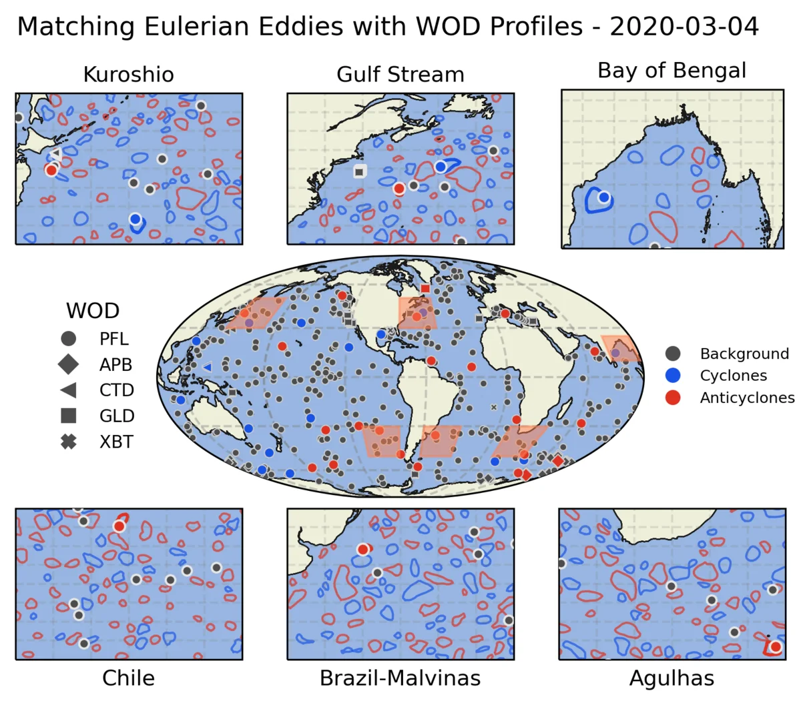
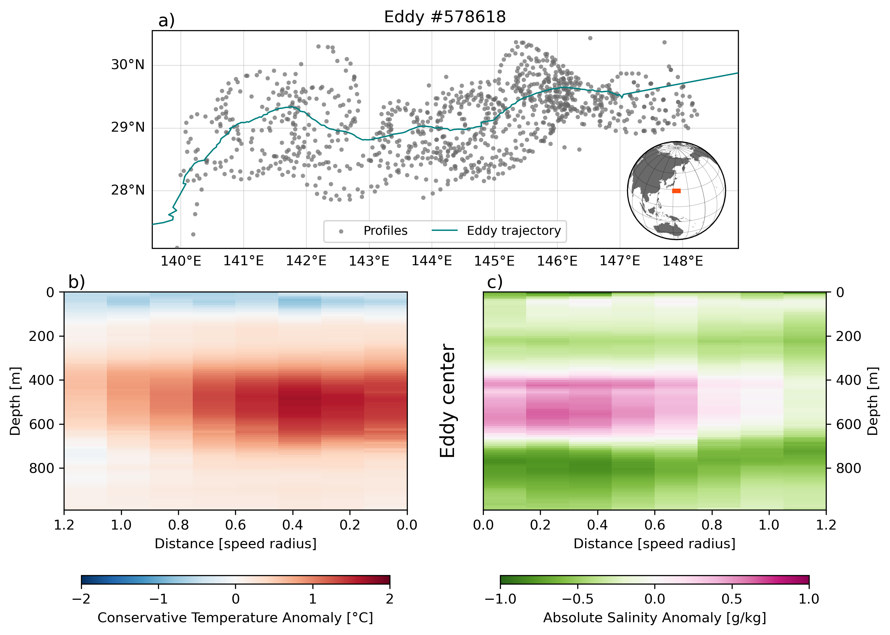

Satellite altimetry reveals ocean mesoscale eddies globally, but their vertical structure remains a computational challenge to study at scale. I combined the World Ocean Database with an altimetry-derived eddy atlas (META3.2 DT), using high-performance computing and parallel Python to match more than 4.2 million quality-controlled profiles to more than 35 million vortex observations.

The resulting dataset is openly available for download and through OPeNDAP, along with the code to reproduce and extend the matching. It supports research on eddy vertical structure, heat, mass and nutrient transport, and water-mass subduction.

```{=html}
<div id="carousel-data-eddy-profiles" class="carousel slide" data-bs-ride="carousel">
  <div class="carousel-inner">
    <div class="carousel-item active">
      <a href="../img/research/multiscale1.webp" class="lightbox" data-gallery="data-eddy-profiles" data-description="Matching altimetry-tracked mesoscale vortices and vertical profiles"></a>
      <div class="carousel-caption"><p>Matching altimetry-tracked mesoscale vortices and vertical profiles</p></div>
    </div>
    <div class="carousel-item">
      <a href="../img/research/eddy_578618_composite.png" class="lightbox" data-gallery="data-eddy-profiles" data-description="Eddy composite analysis combining large ocean datasets and scalable visualization workflows"></a>
      <div class="carousel-caption"><p>Eddy composite analysis combining large ocean datasets and scalable visualization workflows</p></div>
    </div>
  </div>
  <button class="carousel-control-prev" type="button" data-bs-target="#carousel-data-eddy-profiles" data-bs-slide="prev">
    <span class="carousel-control-prev-icon"></span>
  </button>
  <button class="carousel-control-next" type="button" data-bs-target="#carousel-data-eddy-profiles" data-bs-slide="next">
    <span class="carousel-control-next-icon"></span>
  </button>
</div>
```

## Related

- [Paper — Earth System Science Data (2026)](https://doi.org/10.5194/essd-18-1089-2026)

[&larr; All research](../research.qmd)
