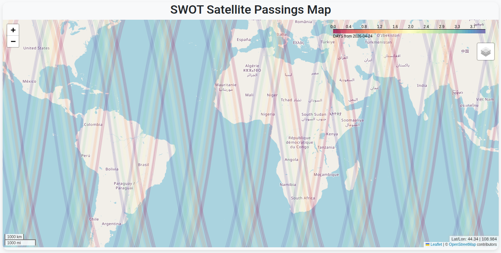
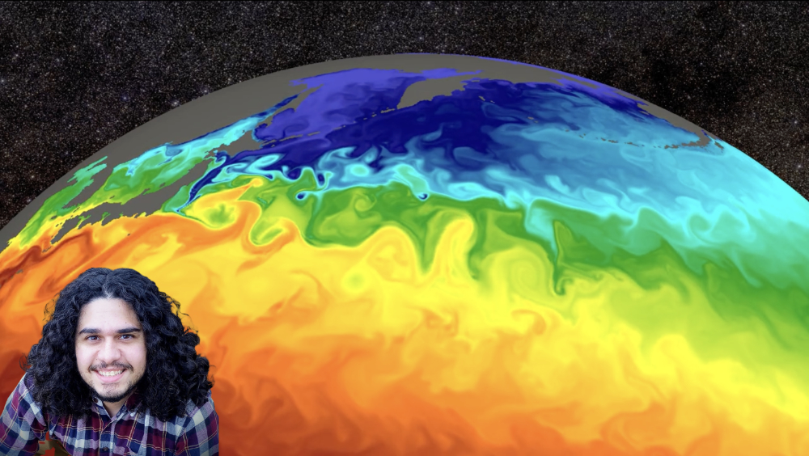

I build open-source tools and workflows that make large datasets accessible to other researchers and stakeholders — from interactive apps to cloud-optimized data access and scalable visualization.

See the [Software](../software.qmd) page for apps, tutorials, and write-ups.

```{=html}
<div id="carousel-data-open-tools" class="carousel slide" data-bs-ride="carousel">
  <div class="carousel-inner">
    <div class="carousel-item active">
      
      <div class="carousel-caption"><p>Where is SWOT? — an interactive app to track the SWOT satellite</p></div>
    </div>
    <div class="carousel-item">
      
      <div class="carousel-caption"><p>Using Icechunk to speed up ocean data access from minutes to seconds</p></div>
    </div>
  </div>
  <button class="carousel-control-prev" type="button" data-bs-target="#carousel-data-open-tools" data-bs-slide="prev">
    <span class="carousel-control-prev-icon"></span>
  </button>
  <button class="carousel-control-next" type="button" data-bs-target="#carousel-data-open-tools" data-bs-slide="next">
    <span class="carousel-control-next-icon"></span>
  </button>
</div>
```

## Related

- [Where is SWOT? (Hugging Face Space)](https://huggingface.co/spaces/iuryt/whereisswot)
- [Icechunk for ocean data (Earthmover blog)](https://www.earthmover.io/blog/from-10-minutes-to-10-seconds-how-woods-hole-scientists-used-icechunk-to-optimize-ocean-data-access)
- [Plotting large vector fields (hvPlot gallery)](https://hvplot.holoviz.org/en/docs/latest/gallery/big-data/large_vectorfield_downsampled.html)

[&larr; All research](../research.qmd)
