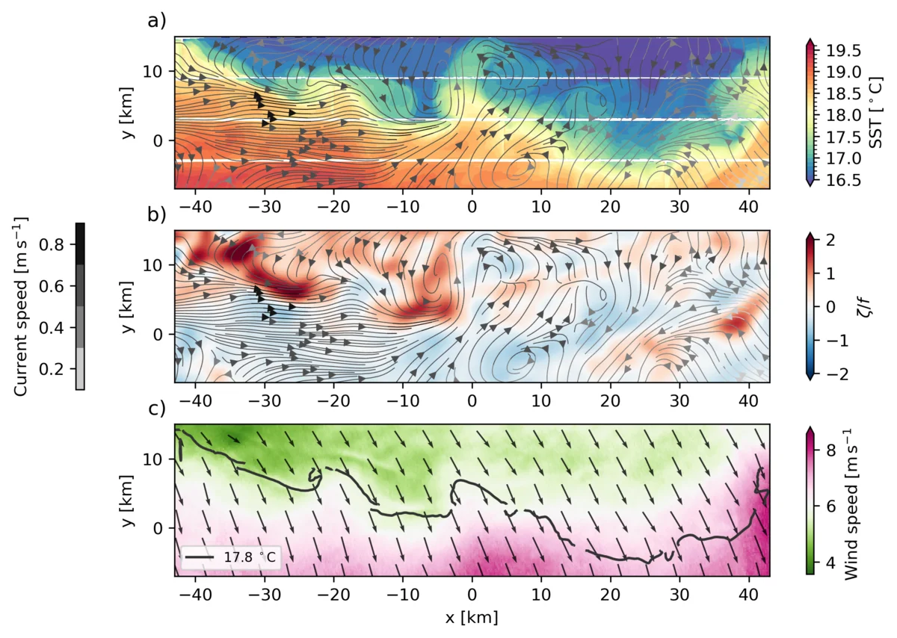
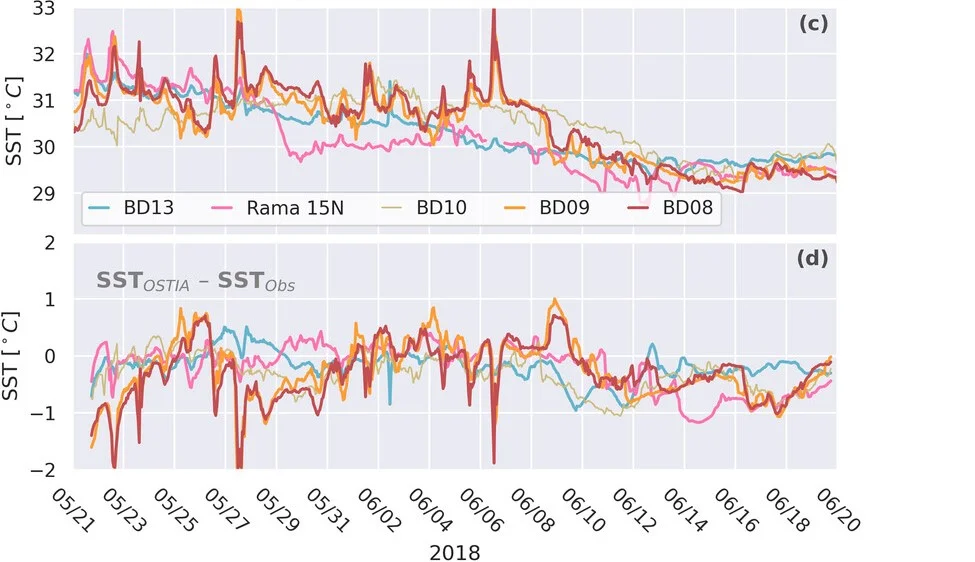
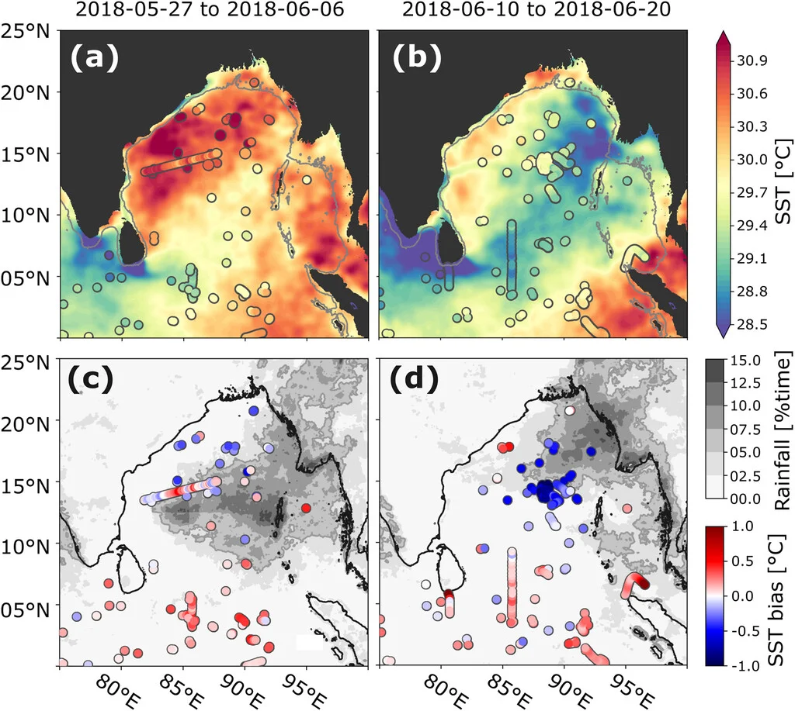

I work with a wide range of ocean-observing technologies, from satellite altimetry and SWOT to DopplerScatt aircraft data, moorings, oceanographic stations, Seagliders, drifters, and Wave Gliders. Bringing these together — and understanding their biases — is the first step toward interpreting multiscale ocean dynamics.

Examples include airborne surface velocity and temperature from the NASA S-MODE campaign and the evaluation of satellite sea surface temperature products against in situ data in the Bay of Bengal.

```{=html}
<div id="carousel-data-remote-sensing" class="carousel slide" data-bs-ride="carousel">
  <div class="carousel-inner">
    <div class="carousel-item active">
      
      <div class="carousel-caption"><p>High-resolution Doppler Scatterometer and airborne sea surface temperatures</p></div>
    </div>
    <div class="carousel-item">
      
      <div class="carousel-caption"><p>Sea surface temperature (SST) biases from satellite products</p></div>
    </div>
    <div class="carousel-item">
      
      <div class="carousel-caption"><p>Combining multiple datasets to investigate SST biases</p></div>
    </div>
  </div>
  <button class="carousel-control-prev" type="button" data-bs-target="#carousel-data-remote-sensing" data-bs-slide="prev">
    <span class="carousel-control-prev-icon"></span>
  </button>
  <button class="carousel-control-next" type="button" data-bs-target="#carousel-data-remote-sensing" data-bs-slide="next">
    <span class="carousel-control-next-icon"></span>
  </button>
</div>
```

## Related

- [S-MODE — Bulletin of the AMS (2025)](https://doi.org/10.1175/BAMS-D-23-0178.1)
- [Bay of Bengal 2018 monsoon onset — Bulletin of the AMS (2021)](https://doi.org/10.1175/BAMS-D-20-0113.1)

[&larr; All research](../research.qmd)
