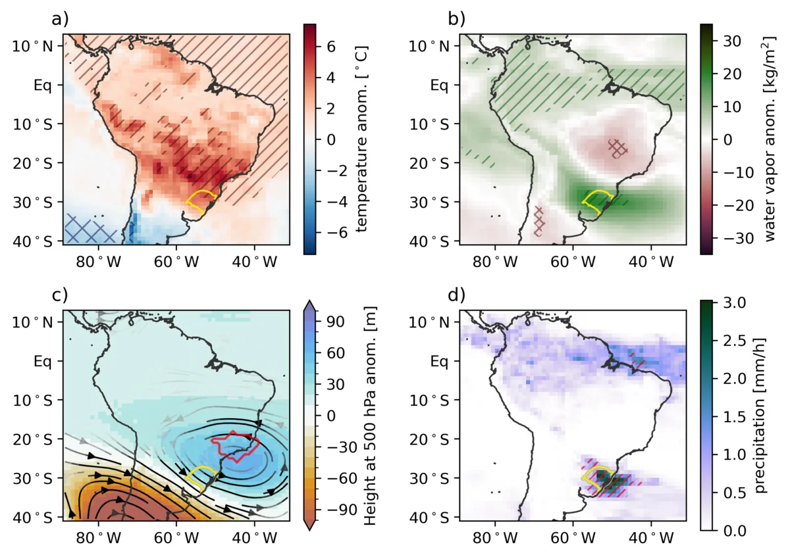
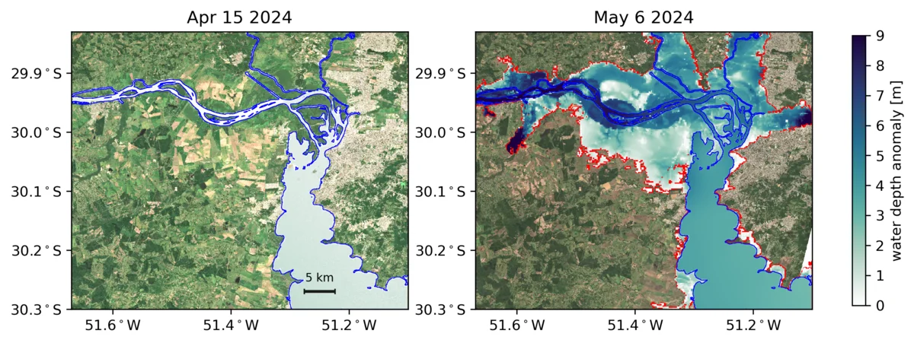
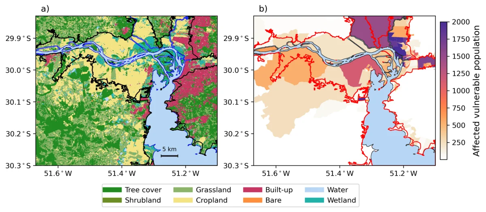

In May 2024, southern Brazil experienced a devastating flood caused by a rare combination of atmospheric conditions: a heatwave stalled a cold front, leading to prolonged and intense rainfall. Combining reanalysis, SWOT and Sentinel-2 observations, topography, and socioeconomic data, we estimated a floodwater volume of about 1.5 billion m³ and found that roughly 420,000 people in the study region were directly affected, about 16% of them socially vulnerable.

The work was featured in [Oceanus Magazine](../posts/southbrazilflood/index.qmd).

```{=html}
<div id="carousel-impacts-floods" class="carousel slide" data-bs-ride="carousel">
  <div class="carousel-inner">
    <div class="carousel-item active">
      <a href="../img/research/large_scale.webp" class="lightbox" data-gallery="impacts-floods" data-description="Atmospheric conditions behind the May 2024 extreme rainfall"></a>
      <div class="carousel-caption"><p>Atmospheric conditions behind the May 2024 extreme rainfall</p></div>
    </div>
    <div class="carousel-item">
      <a href="../img/research/swot_depth.webp" class="lightbox" data-gallery="impacts-floods" data-description="SWOT mission data: estimating extreme flood event volumes"></a>
      <div class="carousel-caption"><p>SWOT mission data: estimating extreme flood event volumes</p></div>
    </div>
    <div class="carousel-item">
      <a href="../img/research/landcover_vulnerable.webp" class="lightbox" data-gallery="impacts-floods" data-description="Geophysical and socioeconomic data: assessing extreme event impacts"></a>
      <div class="carousel-caption"><p>Geophysical and socioeconomic data: assessing extreme event impacts</p></div>
    </div>
  </div>
  <button class="carousel-control-prev" type="button" data-bs-target="#carousel-impacts-floods" data-bs-slide="prev">
    <span class="carousel-control-prev-icon"></span>
  </button>
  <button class="carousel-control-next" type="button" data-bs-target="#carousel-impacts-floods" data-bs-slide="next">
    <span class="carousel-control-next-icon"></span>
  </button>
</div>
```

## Related

- [The May 2024 Flood Disaster in Southern Brazil — Geophysical Research Letters (2025)](https://doi.org/10.1029/2024GL112442)

[&larr; All research](../research.qmd)
