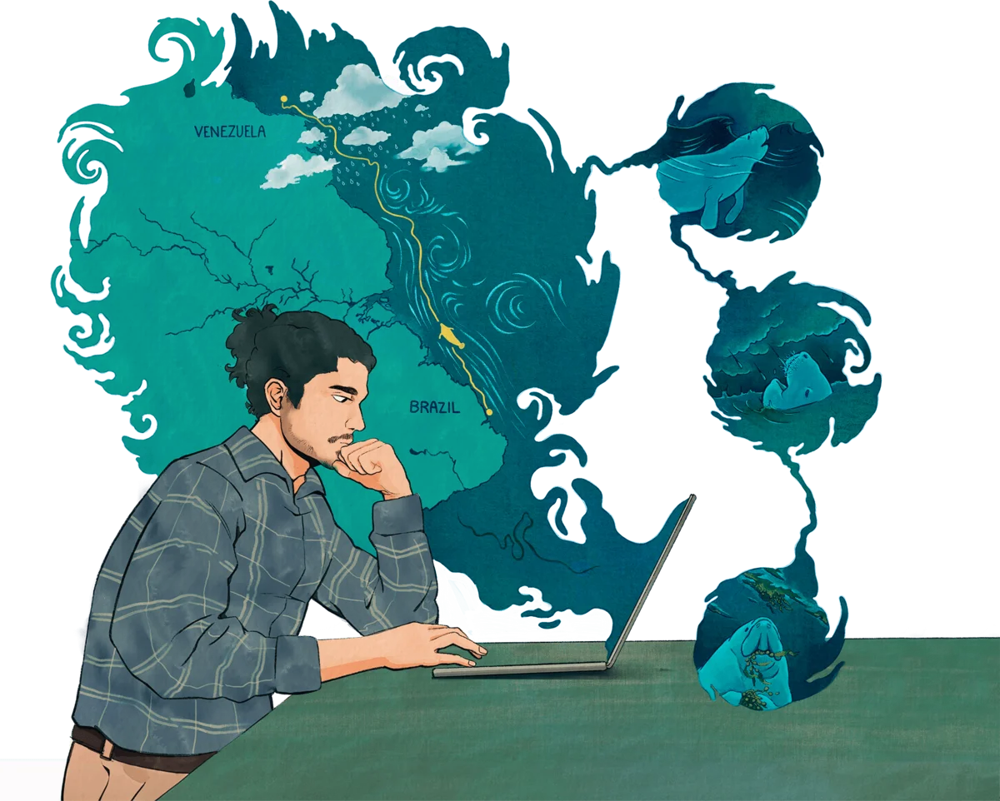
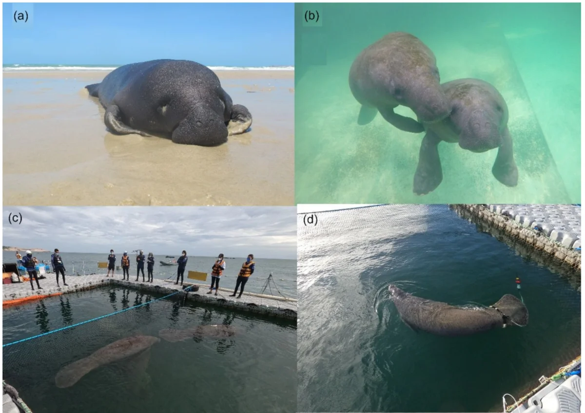
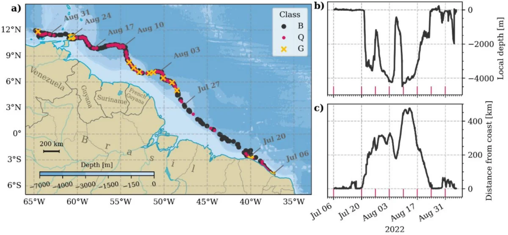
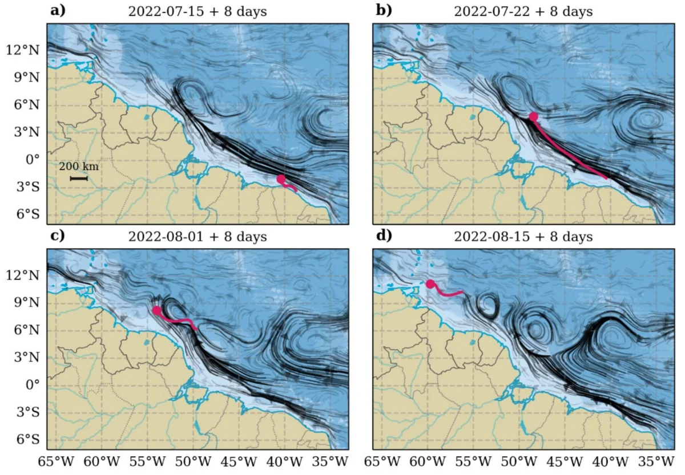
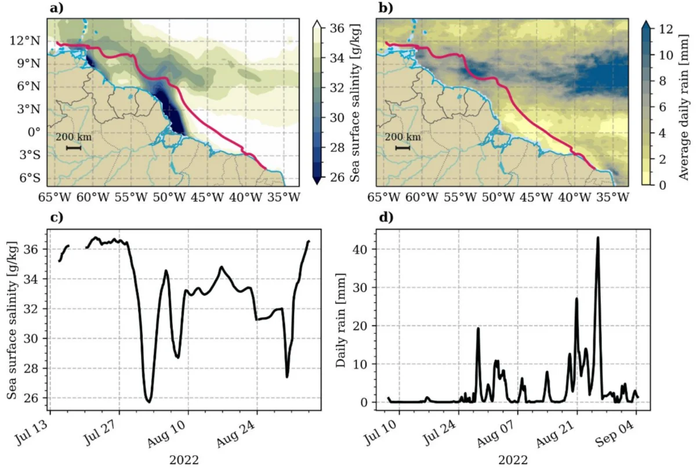

This research explores how oceanographic and atmospheric conditions affect the conservation of endangered species, using remote sensing and predictive modeling. It began with Tico's journey — the longest recorded distance traveled by a released West Indian manatee — in collaboration with [AQUASIS](https://aquasis.org/).

The story was featured in [Oceanus Magazine](../posts/saving-tico/index.qmd) and on the [Rádio Novelo Apresenta](../posts/radionovelo_tico/index.qmd) podcast. The code is available on [GitHub](https://github.com/iuryt/tico_peixeboi).

```{=html}
<div id="carousel-impacts-wildlife" class="carousel slide" data-bs-ride="carousel">
  <div class="carousel-inner">
    <div class="carousel-item active">
      
      <div class="carousel-caption"><p>Saving Tico — Oceanus Magazine. Illustration by Charin Park</p></div>
    </div>
    <div class="carousel-item">
      
      <div class="carousel-caption"><p>Tico and his brother from rescue to release</p></div>
    </div>
    <div class="carousel-item">
      
      <div class="carousel-caption"><p>Tico's journey from Brazil to Venezuela</p></div>
    </div>
    <div class="carousel-item">
      
      <div class="carousel-caption"><p>Tico surfing the currents</p></div>
    </div>
    <div class="carousel-item">
      
      <div class="carousel-caption"><p>Freshwater availability</p></div>
    </div>
  </div>
  <button class="carousel-control-prev" type="button" data-bs-target="#carousel-impacts-wildlife" data-bs-slide="prev">
    <span class="carousel-control-prev-icon"></span>
  </button>
  <button class="carousel-control-next" type="button" data-bs-target="#carousel-impacts-wildlife" data-bs-slide="next">
    <span class="carousel-control-next-icon"></span>
  </button>
</div>
```

## Related

- [The longest documented travel by a West Indian manatee — J. Marine Biological Association UK (2024)](https://doi.org/10.1017/S0025315424000894)

[&larr; All research](../research.qmd)
