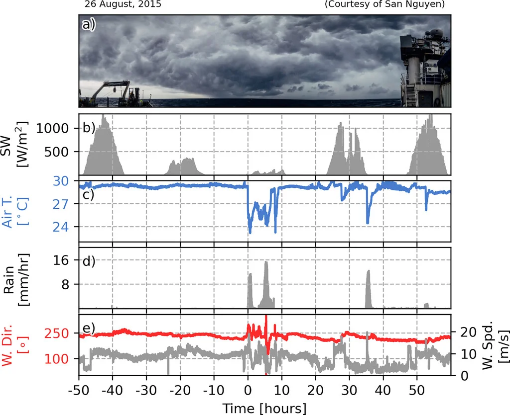
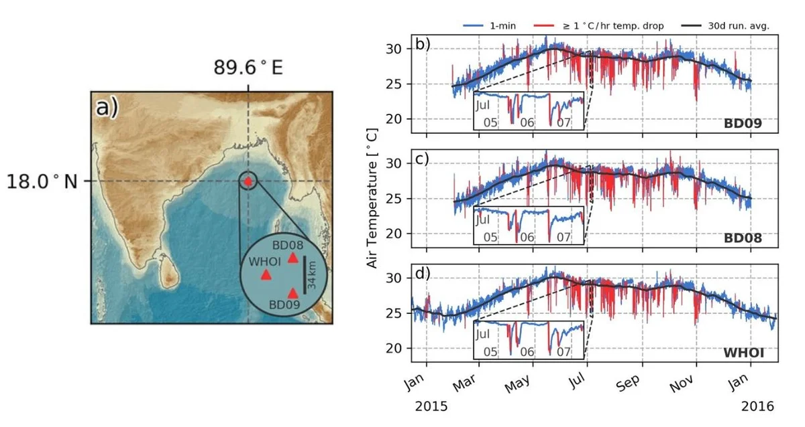
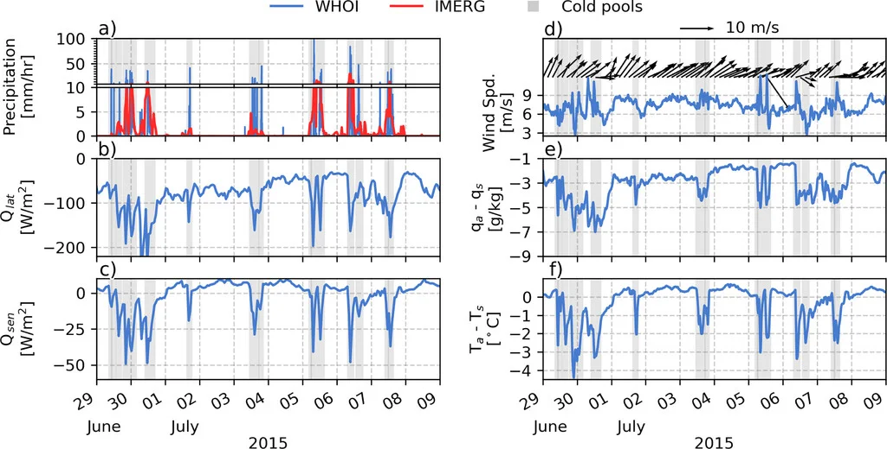
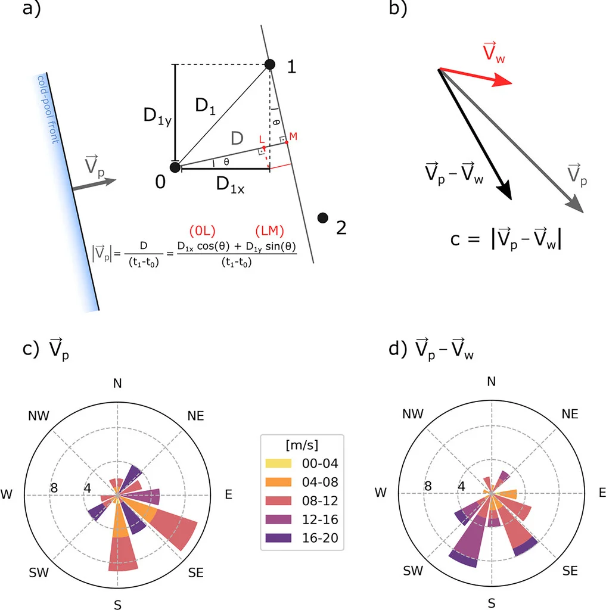

Using mooring data from the Bay of Bengal, I characterized hundreds of atmospheric cold pools — evaporatively driven downdrafts from precipitating clouds — and quantified their role in air–sea heat fluxes and monsoon rainfall, from both atmospheric and oceanographic perspectives.

```{=html}
<div id="carousel-physics-airsea" class="carousel slide" data-bs-ride="carousel">
  <div class="carousel-inner">
    <div class="carousel-item active">
      <a href="../img/research/coldpool1.webp" class="lightbox" data-gallery="physics-airsea" data-description="Intense atmospheric cold pool in the Bay of Bengal"></a>
      <div class="carousel-caption"><p>Intense atmospheric cold pool in the Bay of Bengal</p></div>
    </div>
    <div class="carousel-item">
      <a href="../img/research/coldpool2.webp" class="lightbox" data-gallery="physics-airsea" data-description="Identifying atmospheric cold pools from time series"></a>
      <div class="carousel-caption"><p>Identifying atmospheric cold pools from time series</p></div>
    </div>
    <div class="carousel-item">
      <a href="../img/research/coldpool3.webp" class="lightbox" data-gallery="physics-airsea" data-description="The role of atmospheric cold pools on air-sea heat fluxes"></a>
      <div class="carousel-caption"><p>The role of atmospheric cold pools on air-sea heat fluxes</p></div>
    </div>
    <div class="carousel-item">
      <a href="../img/research/coldpool4.webp" class="lightbox" data-gallery="physics-airsea" data-description="Estimating the direction of propagation of cold pools"></a>
      <div class="carousel-caption"><p>Estimating the direction of propagation of cold pools</p></div>
    </div>
  </div>
  <button class="carousel-control-prev" type="button" data-bs-target="#carousel-physics-airsea" data-bs-slide="prev">
    <span class="carousel-control-prev-icon"></span>
  </button>
  <button class="carousel-control-next" type="button" data-bs-target="#carousel-physics-airsea" data-bs-slide="next">
    <span class="carousel-control-next-icon"></span>
  </button>
</div>
```

## Related

- [Atmospheric Cold Pools in the Bay of Bengal — J. Atmospheric Sciences (2022)](https://doi.org/10.1175/JAS-D-22-0041.1)

[&larr; All research](../research.qmd)
