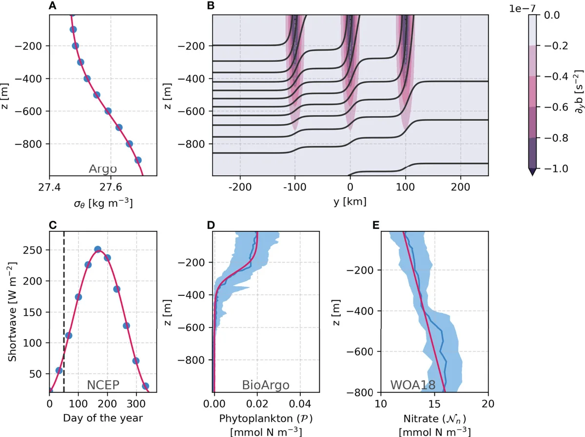
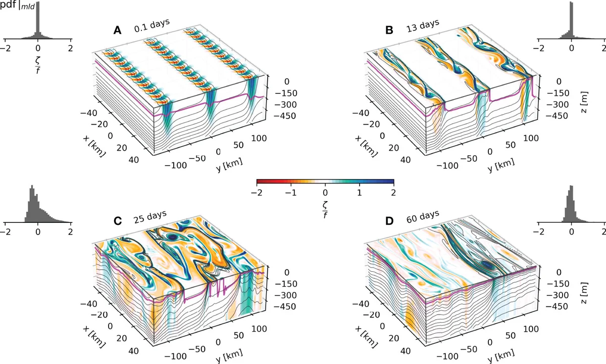

Mixed layer eddies arising from baroclinic instability of fronts convert horizontal buoyancy gradients into vertical stratification. Using high-performance, GPU-accelerated models, I study these submesoscale processes and how well coarse-resolution parameterizations capture them.

The code for the simulations and analyses is available on [GitHub](https://github.com/iuryt/NorthAtlanticBloom).

```{=html}
<div id="carousel-physics-fronts" class="carousel slide" data-bs-ride="carousel">
  <div class="carousel-inner">
    <div class="carousel-item active">
      
      <div class="carousel-caption"><p>Modeling submesoscale fronts and biogeochemical tracers</p></div>
    </div>
    <div class="carousel-item">
      
      <div class="carousel-caption"><p>Submesoscale process modeling on GPUs</p></div>
    </div>
  </div>
  <button class="carousel-control-prev" type="button" data-bs-target="#carousel-physics-fronts" data-bs-slide="prev">
    <span class="carousel-control-prev-icon"></span>
  </button>
  <button class="carousel-control-next" type="button" data-bs-target="#carousel-physics-fronts" data-bs-slide="next">
    <span class="carousel-control-next-icon"></span>
  </button>
</div>
```

## Related

- [Mixed layer eddies and the spring bloom — Frontiers in Marine Science (2022)](https://doi.org/10.3389/fmars.2022.825027)

[&larr; All research](../research.qmd)
