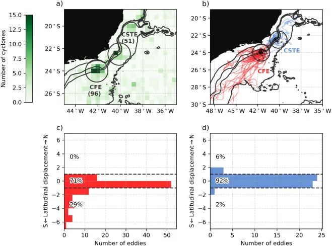
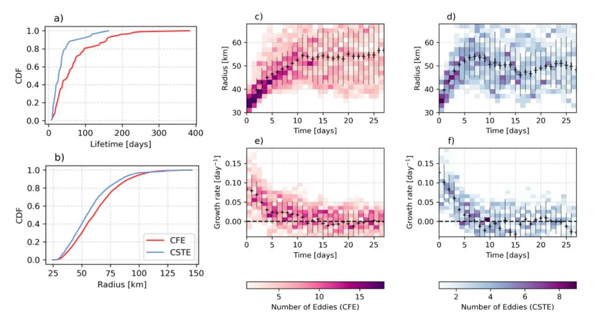
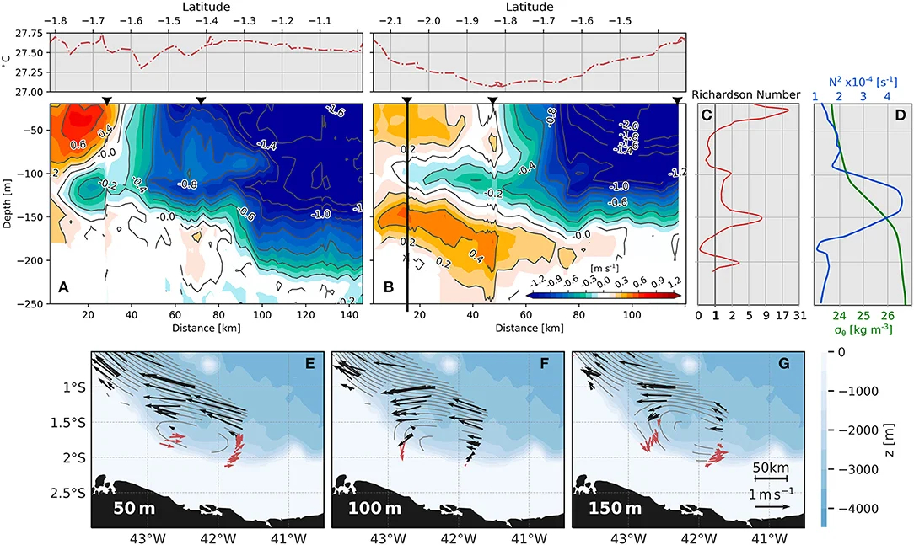
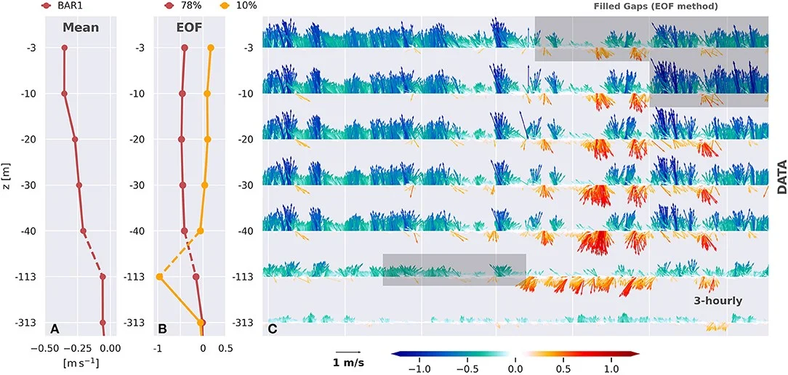
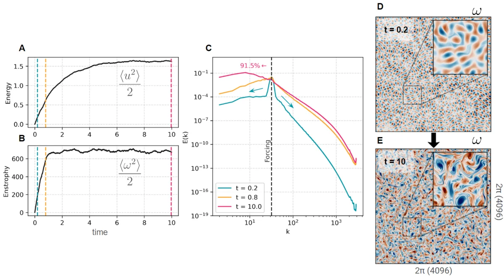

Ocean vortices span scales from hundreds of kilometers down to a few kilometers. Combining observations, tracking algorithms, and idealized simulations, I study how they form, grow, propagate, and transport properties — from the Brazil Current system to the near-equatorial Atlantic.

```{=html}
<div id="carousel-physics-vortices" class="carousel slide" data-bs-ride="carousel">
  <div class="carousel-inner">
    <div class="carousel-item active">
      
      <div class="carousel-caption"><p>Tracking origin and paths of mesoscale vortices</p></div>
    </div>
    <div class="carousel-item">
      
      <div class="carousel-caption"><p>The evolution and growth rate of mesoscale vortices</p></div>
    </div>
    <div class="carousel-item">
      
      <div class="carousel-caption"><p>Investigating topographic submesoscale vortices close to the Equator</p></div>
    </div>
    <div class="carousel-item">
      
      <div class="carousel-caption"><p>Time series processing and analysis of ocean moorings</p></div>
    </div>
    <div class="carousel-item">
      
      <div class="carousel-caption"><p>Two-dimensional forced turbulence simulations</p></div>
    </div>
  </div>
  <button class="carousel-control-prev" type="button" data-bs-target="#carousel-physics-vortices" data-bs-slide="prev">
    <span class="carousel-control-prev-icon"></span>
  </button>
  <button class="carousel-control-next" type="button" data-bs-target="#carousel-physics-vortices" data-bs-slide="next">
    <span class="carousel-control-next-icon"></span>
  </button>
</div>
```

## Related

- [The Brazil Current mesoscale eddies — Deep-Sea Research I (2022)](https://doi.org/10.1016/j.dsr.2022.103947)
- [The Barreirinhas Eddies — Frontiers in Marine Science (2021)](https://doi.org/10.3389/fmars.2021.617011)
- [Brazil Current unstable meanders — Progress in Oceanography (2022)](https://doi.org/10.1016/j.pocean.2022.102925)

[&larr; All research](../research.qmd)
