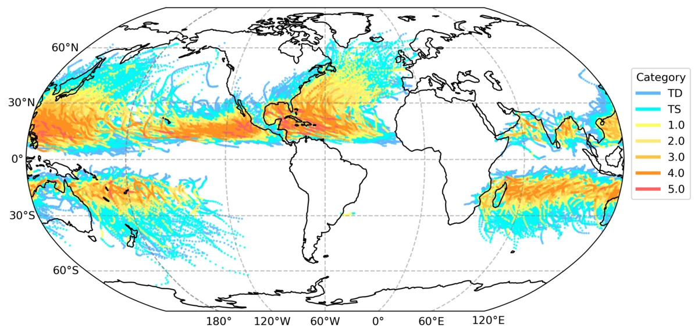
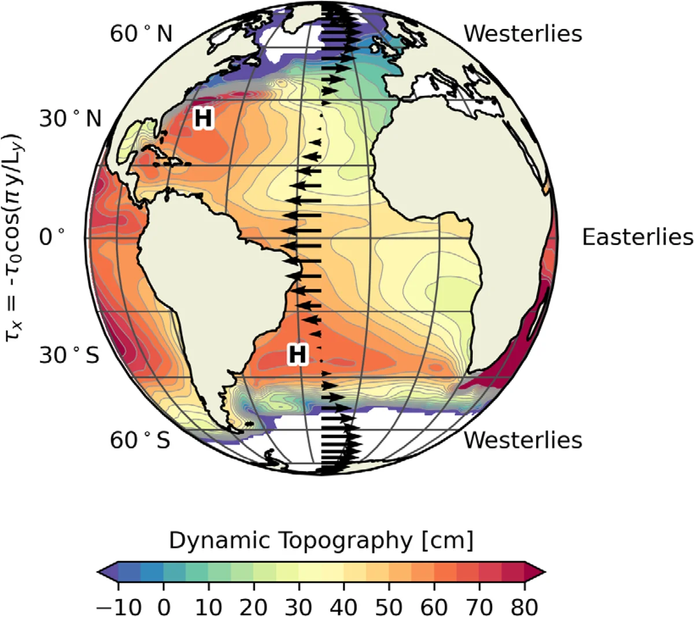
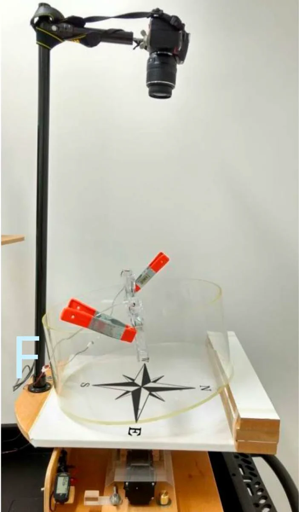
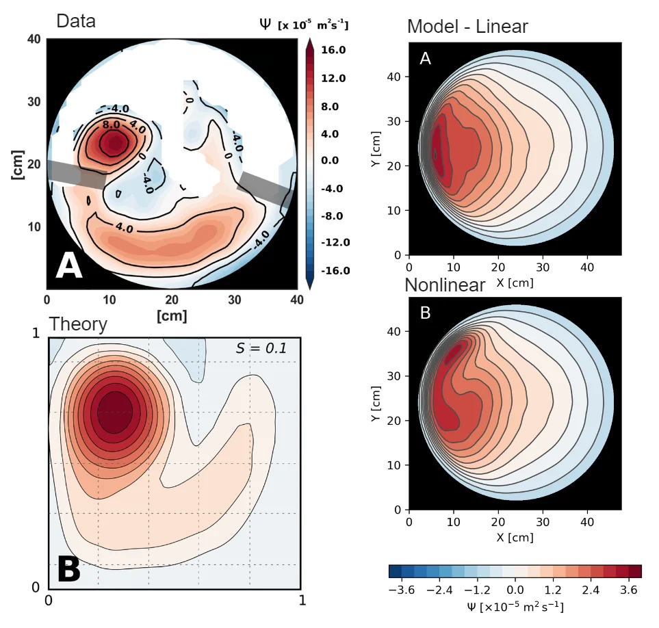

I enjoy finding creative ways to teach ocean and environmental sciences: exploring theory with laboratory experiments, analyzing real-world examples, and running idealized numerical simulations.

```{=html}
<div id="carousel-teaching-hands-on" class="carousel slide" data-bs-ride="carousel">
  <div class="carousel-inner">
    <div class="carousel-item active">
      <video class="d-block w-100" autoplay loop muted playsinline><source src="../img/research/rotating_earth.mp4" type="video/mp4"></video>
      <div class="carousel-caption"><p>Data visualization for teaching: latitude dependence of planetary vorticity</p></div>
    </div>
    <div class="carousel-item">
      
      <div class="carousel-caption"><p>Exploring real-world examples along with theory (hurricane tracks)</p></div>
    </div>
    <div class="carousel-item">
      
      <div class="carousel-caption"><p>Exploring real-world examples along with theory (winds and ocean gyres)</p></div>
    </div>
    <div class="carousel-item">
      
      <div class="carousel-caption"><p>Laboratory experiments on rotating tanks</p></div>
    </div>
    <div class="carousel-item">
      
      <div class="carousel-caption"><p>Simulating laboratory experiments on rotating tanks</p></div>
    </div>
  </div>
  <button class="carousel-control-prev" type="button" data-bs-target="#carousel-teaching-hands-on" data-bs-slide="prev">
    <span class="carousel-control-prev-icon"></span>
  </button>
  <button class="carousel-control-next" type="button" data-bs-target="#carousel-teaching-hands-on" data-bs-slide="next">
    <span class="carousel-control-next-icon"></span>
  </button>
</div>
```

## Related

- [Munk's ocean circulation in a rotating tank — Ocean and Coastal Research (2021)](https://doi.org/10.1590/2675-2824069.20-011psp)

[&larr; All research](../research.qmd)
